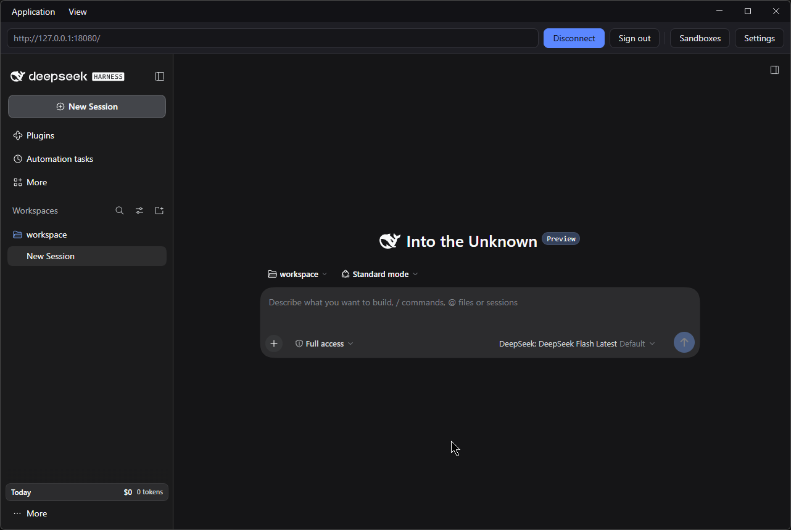
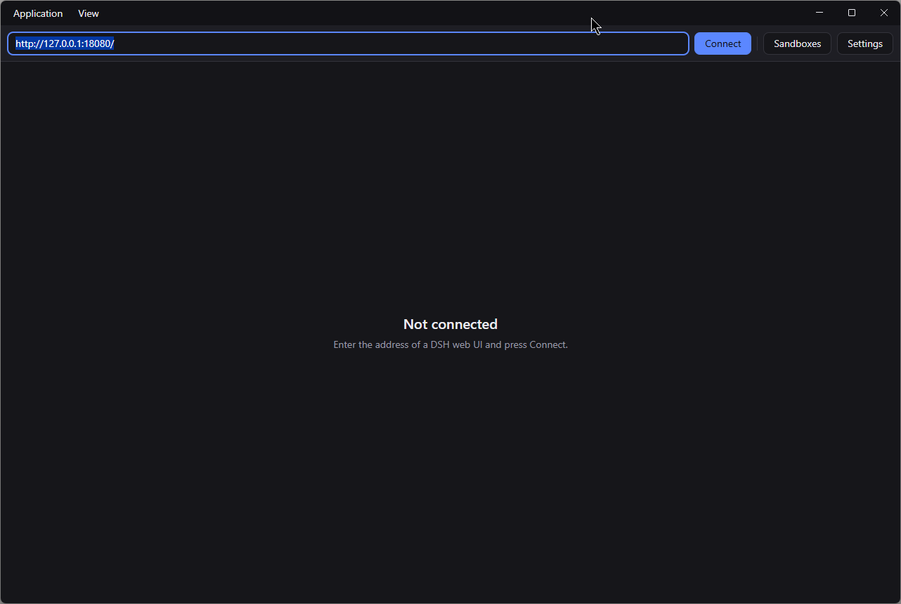
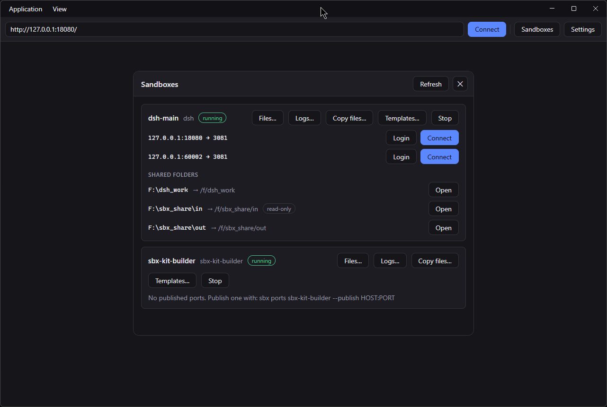
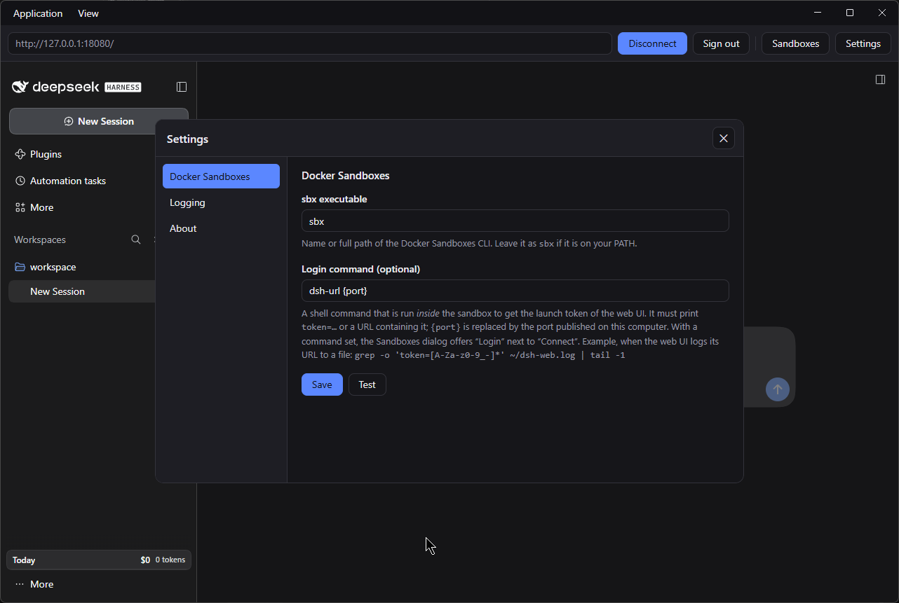

# dsh-sbx-client

A small Electron app that shows the web UI of a [DeepSeek Harness](https://github.com/deepseek-ai/deepseek-harness) (DSH) instance running somewhere else, for example inside a [Docker Sandbox](https://docs.docker.com/ai/sandboxes/), in a desktop window. On top of that it adds convenience tools for the local sandboxes: start and stop, a file browser, file copy, a log viewer and templates.

DSH's own desktop app always starts a local host and cannot attach to an existing one. This client does the opposite: it starts nothing. It loads the address you give it and keeps your session between launches.

This is an unofficial community project and is not affiliated with DeepSeek or Docker. It is developed and tested on Windows.

> **Companion kit:** this client is made to be used together with **[dsh-sbx-kit](https://github.com/JakobBonhoeffer/dsh-sbx-kit)**, a Docker Sandboxes kit that builds a sandbox with DSH, starts its web UI on every boot and publishes it on a loopback port. The kit builds and runs the sandbox, this client is the window onto it. Together they give you DSH on your desktop with the agent kept inside a sandbox. The client also works with any other reachable DSH web UI.

## Screenshots

| Connected to a DSH web UI | Not connected |
| --- | --- |
|  |  |

The Sandboxes dialog lists your local sandboxes with status, published ports and shared folders, and connects with one click:





## Features

### Connect

- Enter the address of a DSH web UI and connect or disconnect.
- The last address that worked is saved and suggested on the next start.
- The session cookie is kept in a dedicated persistent profile, so the launch token is only needed once. "Sign out" deletes that profile.
- The remote page runs sandboxed without any access to the app's own API. Navigation is limited to the connected origin; other links open in the system browser.

### Docker Sandboxes tools

These need the [`sbx` CLI](https://docs.docker.com/ai/sandboxes/). Everything is local; cloud sandboxes are not handled.

- **Sandboxes dialog** (toolbar button or Application menu): lists your local sandboxes with their status and published loopback ports, refreshes automatically, and connects the main window to a published port with one click.
- **Start and stop** from the dialog. Stopping asks for a second click and disconnects the main window first if it shows that sandbox. If the last address you connected to belongs to the sandbox you start, the app reconnects on its own as soon as the web UI answers (up to 90 seconds, cancel with the Cancel button).
- **Login button** (optional): if you set a [login command](#login-command), each published port gets a "Login" button next to "Connect". It fetches the launch token from inside the sandbox and connects with it, for when your saved session has expired.
- **Shared folders:** each sandbox card lists the folders of this computer that are mounted into it, with the path they have inside the sandbox and a "read-only" note where it applies. "Open" shows the folder in the file explorer. A mounted single file is only revealed, never opened.
- **File browser** ("Files…" on a running sandbox): a small explorer with the folder tree on the left (quick access to the home folder and the shared folders, sub-folders load when you open them) and the contents of the current folder on the right (folders first, size, date). Click to select, Ctrl and Shift for several, double-click to enter a folder, Backspace for the parent folder, F5 to refresh, and an editable address bar. "Copy to host…" (button or right click) copies the selection to a folder you choose on this computer. Very large folders show only their first 2000 entries.

  You can also change things there: **Upload here…** copies files from this computer into the open folder, **New folder**, **Rename** (F2) and **Delete** (Del) work in place like in a file explorer. Safety rules: deleting always asks first (with "Cancel" preselected) and cannot be undone; the file system root, every top-level folder, your home folder and its parents, and every shared folder (and any folder that contains one) can never be deleted or renamed; deleting inside a shared folder shows an extra warning that the files disappear on this computer too; an existing item is never replaced by a rename or a new folder, and replacing during an upload needs a confirmation.
- **Copy files** between this computer and a running sandbox ("Copy files…" on the sandbox card): upload files or a folder into a folder of the sandbox, or download a file or folder from it. You pick the files on this computer in the normal Windows dialogs. Next to both sandbox path fields, **Browse…** opens the file browser as a picker. If an item with the same name already exists, you are asked before it is replaced (`sbx cp` would overwrite silently). Uploaded items are handed to the regular sandbox user, because `sbx cp` creates them as root.
- **Log viewer** ("Logs…" on a running sandbox, or "View as log" in the file browser's context menu): reads a text log inside the sandbox. Enter a path, pick one with **Browse…**, or open the list of `*.log` files found in the home folder, the shared folders, `/var/log` and `/tmp` (newest first). It shows the last 200, 500, 1000 or 5000 lines (at most 1 MB) and **follows** the file: every 2 seconds it reads only what was added, and a line that is still being written is completed in place. There is a filter field (case-insensitive), a wrap switch, **Copy** and **Save to host…** (both take what the view shows, so a filter applies). Terminal colors are removed, binary files are refused, and `token=…` is hidden while "Mask tokens in the log viewer" is on (Settings, Logging). If the file is rotated or emptied the view starts over; if it disappears for a moment, the viewer keeps trying. Following pauses while the window is hidden.
- **Templates** ("Templates…" on every sandbox card, running or not): **Save template** takes a snapshot of that sandbox as a template (`sbx template save`), optionally also as a tar file to use on another computer. The list shows the templates of this computer (the image store is shared by all sandboxes) with name, kind, size and date, **Delete** (always asks first, "Cancel" preselected) and **Load from tar file…**. Saving a running sandbox asks for confirmation because a snapshot may interrupt or stop it. A new sandbox is created from a template with `sbx run --pull never -t NAME AGENT`.

### The app itself

- **Settings dialog** (toolbar button or Application menu): navigation on the left, settings on the right: the path of the `sbx` executable (with a test button), the optional login command, logging, and an About page.
- **Application log** (Application menu): shows the app's own [log](#logging) in the same viewer, including its rotated files.
- The window has no native title bar. The menus **Application** (Sandboxes, Settings, Application log, Exit) and **View** (reload, zoom, full screen, developer tools) sit in the draggable top bar next to the Windows window buttons. Reload is F5.
- Dialogs open inside the main window, centered over the page, so they follow the window to any monitor and add nothing to the taskbar. Close them with the X button or Escape.

## Download

Windows builds are attached to each release on the [Releases page](https://github.com/JakobBonhoeffer/dsh-sbx-client/releases): an installer (`…-setup.exe`) and a portable single file (`…-portable.exe`), each with a SHA-256 checksum in `SHA256SUMS.txt`.

The builds are **not code-signed** yet, so Windows SmartScreen may warn on first start ("More info", then "Run anyway"). If you prefer not to trust a binary, [build it from source](#development). Verify a download with `certutil -hashfile <file> SHA256` and compare it with `SHA256SUMS.txt`.

## Requirements

- Node.js 22 or newer
- [pnpm](https://pnpm.io/) 11 (`corepack enable pnpm` or `npm install -g pnpm`)
- A reachable DSH web UI, started with `dsh web`
- For the sandbox tools: the [`sbx` CLI](https://docs.docker.com/ai/sandboxes/) on your `PATH` (or its path set in the Settings)

## Usage

1. Start DSH so that its web UI is reachable from this machine, for example `dsh web` (listens on `http://127.0.0.1:3080/`), or the published port of a sandbox.
2. Start the client, enter the address, press **Connect**.
3. On the first connection add the launch token that DSH prints, for example `http://127.0.0.1:3080/?token=...`. The token is exchanged for a session cookie and is never stored by this app.

DSH only accepts requests whose `Host` header is a loopback address or an explicitly trusted host. To use a non-loopback address, start DSH with `--trusted-host`. See the DSH documentation on public deployments.

## Development

```sh
pnpm install
pnpm dev          # start with hot reload
pnpm typecheck    # type-check main, preload and renderer
pnpm test         # unit tests of the pure modules
pnpm build        # production build into out/
pnpm start        # run the production build
pnpm dist         # build the Windows installer and portable exe into release/
pnpm dist:dir     # build only the unpacked app (fast check of the packaging)
pnpm icons        # re-render build/icon.png from build/icon.svg
```

Contributions are welcome. [AGENTS.md](AGENTS.md) describes the layout, the design rules that keep the app safe (what a page may ask for and what only the main process decides) and how to test. It is written for AI coding agents and for people alike.

## Building the installer

`pnpm dist` writes two files to `release/` (Windows x64):

| File | Description |
|---|---|
| `dsh-sbx-client-<version>-setup.exe` | NSIS installer, per-user, lets you choose the install folder |
| `dsh-sbx-client-<version>-portable.exe` | Single file, runs without installing |

The installer installs into **exactly the folder shown** in its directory field; it does not add a hidden subfolder. To stay safe with arbitrary folders:

- A new or empty folder, or an existing install of this app, is used as chosen.
- A folder that already contains other files is never installed into directly. The installer asks for confirmation and then uses the subfolder `DSH sbx client` inside it (silent installs accept this automatically).
- The uninstaller deletes only the files that were installed (listed in `install-manifest.txt`, generated at build time) and the app's `logs` folder, and removes the folder only if nothing else is left in it.

The builds are **not code-signed**, so Windows SmartScreen may show a warning on first start ("More info" then "Run anyway"). The first build downloads Electron and the NSIS tooling, so it needs internet access.

The icon is an original drawing (a whale inside a container). Edit `build/icon.svg`, then run `pnpm icons`.

## Logging

The app keeps its own log in a `logs` folder: next to the program for an installed build (`<install folder>\logs`), next to the exe for the portable build (the portable exe unpacks itself to a temporary folder, so that would lose the logs), and in the project folder when run from source. If that folder is not writable, the per-user log folder is used instead and the Settings say so. The Settings dialog has a **Logging** section with the log level, the token-masking switch for the log viewer, the folder path and "Open log folder". The log can be read in the app: Application menu, **Application log…**.

- File: `dsh-sbx-client.log`, rotated at 5 MB, five files kept (`dsh-sbx-client.1.log` … `.4.log`).
- Levels: `error`, `warn`, `info` (default), `debug`. A change applies at once. `debug` also records every `sbx` call (the call and its duration, never its output).
- What is logged at `info`: start and exit with versions, connect and disconnect (address without token), starting and stopping sandboxes, file operations (uploads, downloads, new folders, renames, deletions with their paths), opened logs and template actions, settings changes (names only, never the login command), and all errors including crashed pages and unhandled exceptions. Refused requests (an IPC call from a view that may not make it, deletes of protected paths) are warnings.
- Launch tokens never reach the file: every line is masked before it is written.

## Login command

The web UI only prints its launch token once, when `dsh web` starts, and DSH has no command to show it again. Where that output ends up depends on how you run DSH, so the app does not guess: you can give it a command that finds the token for you.

In Settings, under Docker Sandboxes, set **Login command**. It runs *inside* the sandbox (as `sh -c <command>` through `sbx exec`), never on your computer, and must print `token=<value>` or a URL containing it. If the output contains several tokens, the last one is used. `{port}` in the command is replaced by the port published on this computer.

Examples, depending on where your sandbox keeps the web UI's startup output:

```sh
grep -o 'token=[A-Za-z0-9_-]*' ~/dsh-web.log | tail -1
my-url-script {port}
```

With the [dsh-sbx-kit](https://github.com/JakobBonhoeffer/dsh-sbx-kit) sandbox, set the login command to `dsh-url {port}`. The kit installs that helper, and it prints the web UI address with the current token.

The app uses only the token from the output. The address it opens is always built from the published port (`http://127.0.0.1:<port>/?token=…`), and the token is never stored or logged. With an empty command (the default) the Login button is not shown and you paste the URL with token by hand.

## Settings

Stored as `settings.json` in the Electron user data directory (`%APPDATA%\dsh-sbx-client` on Windows).

| Key | Meaning |
|---|---|
| `lastUrl` | Last address that connected successfully, without launch token. Suggested on the next start. |
| `sbxPath` | Name or full path of the `sbx` CLI. Default `sbx` (found through your PATH). Editable in the Settings dialog. |
| `tokenCommand` | Optional [login command](#login-command) run inside a sandbox to get the launch token. Default empty (feature off). Editable in the Settings dialog. |
| `logLevel` | `error`, `warn`, `info` (default) or `debug`: how much the app writes to its own [log](#logging). Editable in the Settings dialog. |
| `maskTokens` | Default `true`. Mask `token=…` in sandbox logs shown by the log viewer (view, filter, copy and save). Turn it off if you want to see the tokens. Editable in the Settings dialog. |

If nothing was saved yet, `http://127.0.0.1:3080/` (the default address of `dsh web`) is suggested.

## Security notes

- The app only loads `http` and `https` addresses and refuses addresses with embedded credentials.
- Plain `http` is intended for loopback addresses. Do not use it across untrusted networks.
- The remote view has no preload script, runs with `sandbox` and `contextIsolation`, and cannot reach the app's IPC API.
- Permission requests of the remote page (camera, microphone, notifications, and so on) are not granted.
- Paths on your computer are only ever chosen in the system's own file dialogs, never by a page. Things that cannot be undone (deleting files, deleting templates) ask first.

## Related projects

- [dsh-sbx-kit](https://github.com/JakobBonhoeffer/dsh-sbx-kit): Docker Sandboxes kit that runs the DSH web UI in a microVM. Use it with this client.
- [DeepSeek Harness](https://github.com/deepseek-ai/deepseek-harness)
- [Docker Sandboxes](https://docs.docker.com/ai/sandboxes/)

## License

MIT, see [LICENSE](LICENSE).
